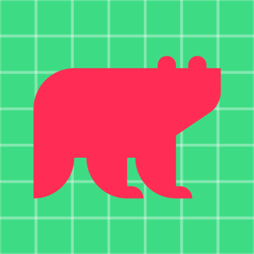

<p align="center">
  
</p>

<h1 align="center">Bandaedge 🎓</h1>

<p align="center">
  A student productivity app for Android, built with Kotlin and Jetpack Compose.
</p>

<p align="center">
  
  
  
  
</p>

---

## 📖 About

Bandaedge helps students stay organized and productive. The long-term goal is
to let students upload lectures (PDF or PowerPoint) and get simplified Arabic
educational videos generated with AI.

> **Status:** early development. Only the features under "Available now" are built.

## ✨ Features

**Available now**
- Live clock screen with time and date, updated every second
- Material 3 theme with light and dark color schemes

**Planned**
- Arabic and English support with right-to-left layout
- Lecture upload and AI-generated educational videos

## 📸 Screenshots

| Light | Dark |
|:-----:|:----:|
| _coming soon_ | _coming soon_ |

## 🛠️ Tech Stack

- **Kotlin**: main language
- **Jetpack Compose + Material 3**: declarative UI
- **MVVM**: separates UI from logic
- **Coroutines + StateFlow**: async work and UI state

## 📁 Project Structure

```
com.bandaedge/
├── core/
│   └── theme/            # Colors and Material theme
├── presentation/
│   └── screens/
│       └── clock/        # ClockScreen + ClockViewModel
└── MainActivity.kt       # Entry point
```

## 🔧 Setup

1. Clone the repository:
   ```bash
   git clone https://github.com/OmarMadany/bandaedge.git
   ```
2. Open it in Android Studio and wait for Gradle sync.
3. Run on an emulator or a physical device (minSdk XX).

## 🗺️ Roadmap

- [x] Project setup and app icon
- [x] Clock screen
- [x] Light and dark theme
- [ ] Arabic font and RTL support
- [ ] Arabic and English strings
- [ ] Home and lecture upload screens
- [ ] Backend for lecture processing and video generation

## 🎓 What I'm Learning

- MVVM architecture in Jetpack Compose
- State management with StateFlow
- Coroutines for periodic work
- Git workflow: feature branches and conventional commits

## 👤 Author

**Omar Madani** · [GitHub](https://github.com/OmarMadany)
