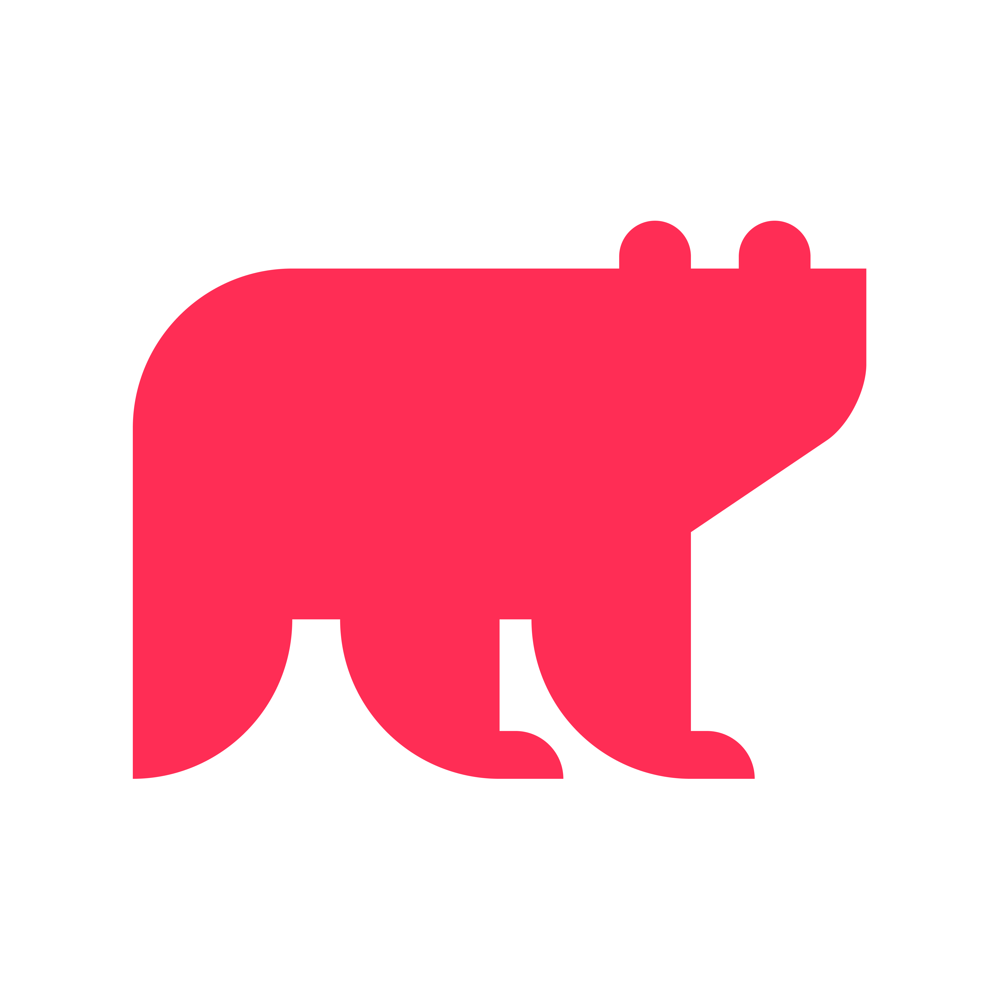

  

<h1 align="center">Bandaedge</h1>

  A student productivity app for Android, built with Kotlin and Jetpack Compose (MVVM). 
  Long-term goal: turn uploaded lectures into simplified Arabic educational videos using AI.

## Screenshots

  
  
  

  
  
  

