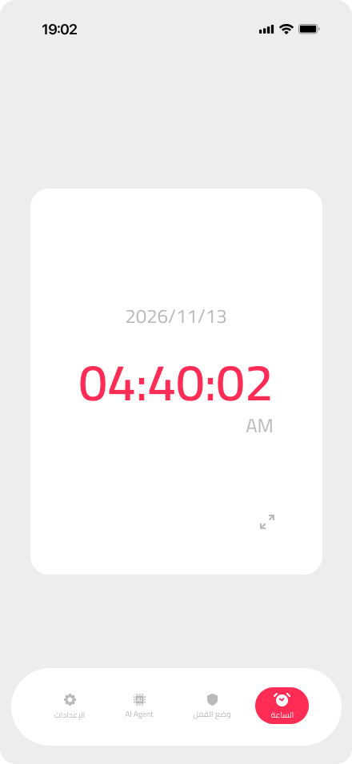
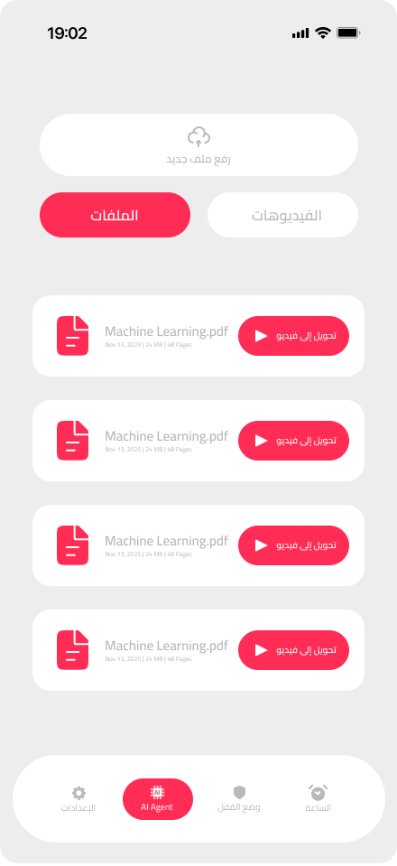
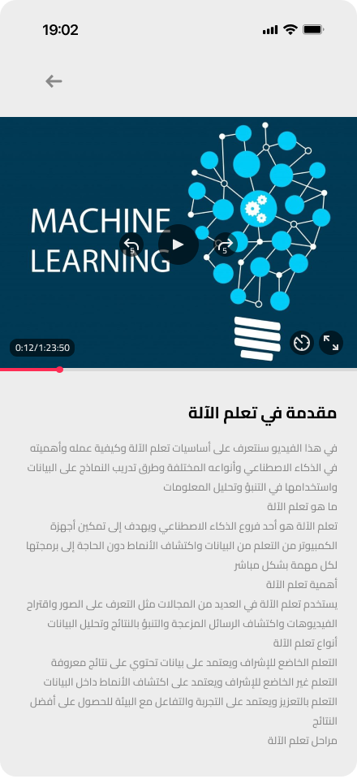
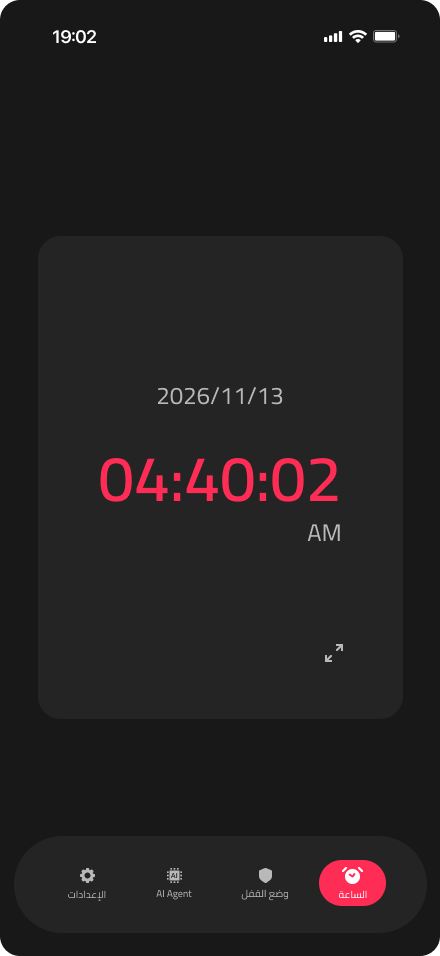
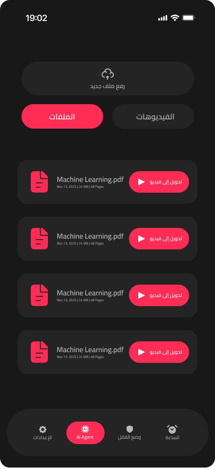
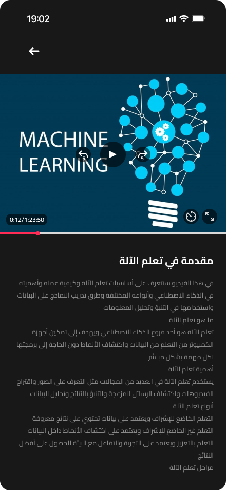

<p align="center">
  
</p>

<h1 align="center">Bandaedge</h1>

<p align="center">
  A student productivity app for Android, built with Kotlin and Jetpack Compose (MVVM).<br/>
  Long-term goal: turn uploaded lectures into simplified Arabic educational videos using AI.
</p>

---

## Screenshots

<p align="center">
  
  
  
</p>

<p align="center">
  
  
  
</p>

---

## Tools Used

<p align="center">
  
  
  
  
  
  
</p>

---

## Project Structure

```
com.bandaedge/
├── core/
│   └── theme/            # Colors and Material theme
├── presentation/
│   └── screens/
│       └── clock/        # ClockScreen + ClockViewModel
└── MainActivity.kt       # Entry point
```

---

## Features

**Available now**
- Live clock screen with time and date, updated every second
- Light and dark themes

**Planned**
- Lecture upload (PDF and PowerPoint)
- AI-generated Arabic educational videos
- Video player with playback speed control
- Files list and settings
- Lock and countdown timer screens
- Arabic and English support with right-to-left layout

---

## Design

🎨 [View the Figma design](https://www.figma.com/design/bZn6JRvUknVxOkl0DjRUkz/Bandaedge)

---

## Contact Me

<p align="center">
  <a href="mailto:omar.madanni@gmail.com">
    
  </a>
  <a href="https://www.linkedin.com/in/omarmadanni/">
    
  </a>
  <a href="https://www.facebook.com/omarmadani111">
    
  </a>
  <a href="https://wa.me/201040755431">
    
  </a>
</p>
